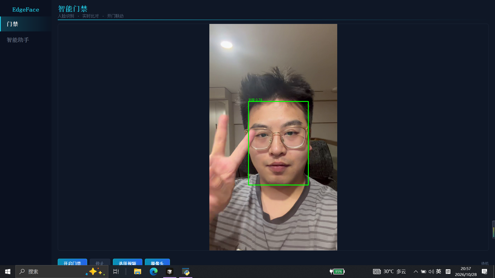
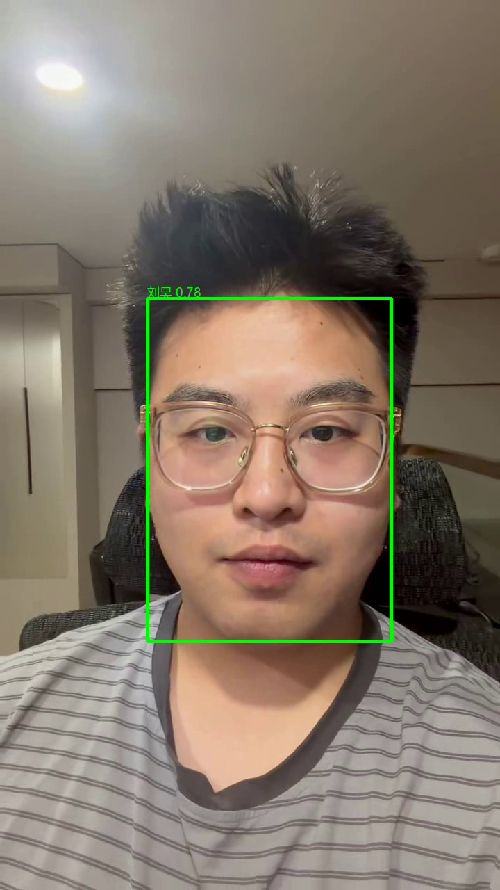
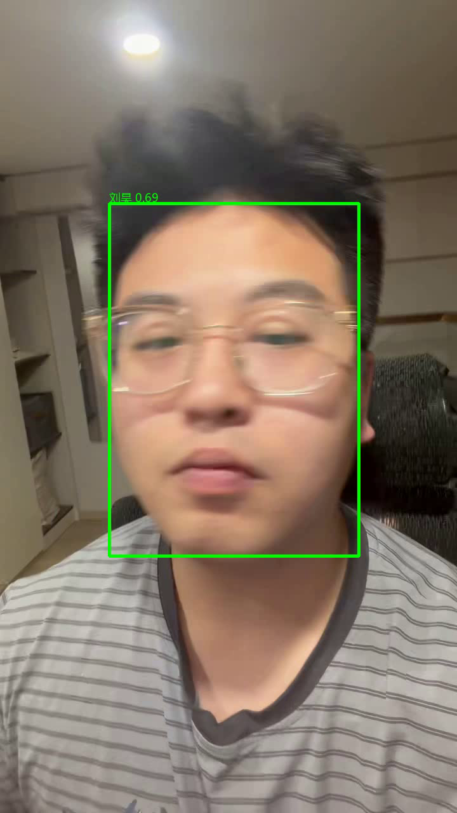

# EdgeFace 智能门禁 · 端侧大模型 Agent 演示项目

**感知 → 决策 → 执行** 三层闭环的端侧 AI 系统：RK3588 板端摄像头实时人脸识别、
命中即开门，大模型对话助手用自然语言操作门禁（开门 / 查记录 / 查名单）。
PC 开发环境用 ONNX + llama.cpp 验证，板端用 RKNN + RKLLM 部署，两端共享同一套代码。

```
感知层：摄像头 → SCRFD 人脸检测 → 5 点对齐 → MobileFaceNet 特征提取 → 余弦比对
决策层：Qwen2.5 对话 agent → 白名单工具调用（open_door / recent_logs / list_users）
执行层：GPIO → 继电器 → 电磁锁开门；识别日志 JSONL 落盘
```

## 演示效果

**门禁页实时识别**（绿框=注册人命中，红框=陌生人，命中后触发开门脉冲）：






**演示录屏**（手机实拍视频 + 识别标注）：`testvideo/ac678b2e5b13a18c54c97ee9f0159e9e_annotated.mp4`

## 使用说明

### 一、环境准备

1. **安装依赖**（Windows 10 + Python 3.11）：

   ```powershell
   pip install -r requirements.txt
   ```

2. **准备识别模型**：首次运行自动下载（insightface buffalo_s，约 250MB），无需手动操作。

3. **准备大模型**（二选一，见下方「大模型后端」小节）：
   - 推荐：安装 [ollama](https://ollama.com/download) 后 `ollama pull qwen2.5:1.5b`
   - 或下载 GGUF 文件放到 `assets/models/llm/`（仓库不含模型文件，需自行下载）

### 二、启动与自检

```powershell
python tools/selftest.py --with-ui     # 环境自检，全部 [OK] 即就绪
python ui/main.py                      # 或双击「启动门禁.bat」
```

登录账号 **admin / 123456**，进入主界面两个页面：

### 三、门禁页：视频识别演示

1. 点「选择视频/摄像头」→ 选 `testvideo/` 里的测试视频（或板端接实时摄像头）
2. 视频自动开始逐帧识别：**绿框** = 注册人命中（触发 FakeDoor 开门脉冲，界面提示开门），**红框** = 陌生人，右下角实时显示识别日志
3. 点「停止」回到初始状态，可换视频重复演示

> 视频文件源一律走 FakeDoor（模拟开门），只有板端实时摄像头才驱动真实 GPIO 继电器——演示安全，不会误开真锁。

### 四、智能助手页：大模型对话

对话操作门禁（首条消息需等模型加载，几秒到几十秒）：

| 试试这样说 | 效果 |
|---|---|
| 帮我开一下门 | 调用 open_door 工具，触发开门脉冲 |
| 今天有谁来过？ | 调出真实识别日志 |
| 有哪些人能开门？ | 列出已注册人员名单 |
| 随便聊聊 | 流式回复，不调工具 |

回复为**流式输出**（首个字秒出），工具执行后直接显示结果；疑问句（如「为什么不能开门」）有安全护栏，不会误触发开门。

### 五、注册你自己的人脸

注册照片放在**项目文件夹外**（个人照片不入仓库）：

```
人脸识别/
├── face_db_raw/          # ← 放这里（项目外，与项目文件夹平级）
│   └── 你的名字/
│       ├── 照片1.jpg      # 每人 5~10 张，一张照片只能有本人一张正脸
│       └── ...
└── 项目/                 # 本仓库
```

```powershell
python tools/register.py            # 默认读 ../face_db_raw，写入 assets/face_db/
# 或指定目录：python tools/register.py --raw D:/photos
```

重新启动门禁页即可用新面孔演示开门。

## 大模型后端（二选一）

| 后端 | 适用场景 | 准备方式 |
|---|---|---|
| **ollama**（推荐） | 有网络、机器性能够 | `ollama pull qwen2.5:1.5b`（内存紧张换 `qwen2.5:0.5b`） |
| **llama.cpp** | 离线 / 低内存 | 下载 GGUF 放 `assets/models/llm/`，程序自动拉起 llama-server |

GGUF 下载（模型文件超过 GitHub 单文件限制，不入仓库）：
- HuggingFace：[Qwen2.5-1.5B-Instruct-GGUF](https://huggingface.co/Qwen/Qwen2.5-1.5B-Instruct-GGUF)（取 `qwen2.5-1.5b-instruct-q4_k_m.gguf`）/[Qwen2.5-0.5B-Instruct-GGUF](https://huggingface.co/Qwen/Qwen2.5-0.5B-Instruct-GGUF)
- 国内镜像：把网址的 `huggingface.co` 换成 `hf-mirror.com`，或到 [ModelScope](https://modelscope.cn/models/Qwen/Qwen2.5-1.5B-Instruct-GGUF) 搜索同名仓库
- llama-server 运行库（exe+DLL）已随仓库提供，无需另装

默认模型 `qwen2.5:1.5b`（改 `ui/pages/assistant_page.py` 顶部 `MODEL` 常量可换 0.5b）。

## 功能特性

| 特性 | 说明 |
|---|---|
| 双后端引擎 | PC：insightface+onnxruntime；板端：rknnlite+NPU，`FaceEngine` 统一接口 |
| 板端后处理对齐验证 | SCRFD 解码+NMS 与 InsightFace 参考实现 **14/14 张图逐位一致**（IoU=1.000、关键点误差 0px） |
| 双阈值判定 | 相似度 ≥0.50 且 top1−top2 ≥0.10 才开门，另加 5s 开门冷却 |
| 大模型 agent | 工具调用白名单 + 三层保障（结构化调用/伪调用解析/规则兜底）+ 疑问句安全护栏，关键操作确定性可执行 |
| 流式对话 | 助手回复逐字流式上屏，工具调用过程不露原始输出 |
| 安全设计 | 视频回放一律 FakeDoor（只有实时摄像头才能驱动真实门锁）；GPIO 经继电器，3.3V 不直连锁 |
| 中文路径兼容 | 全项目图片读写统一走 `edgeface.io`（Windows cv2 中文路径坑已封装） |

## 文档导航

| 文档 | 位置 | 读者 | 内容 |
|---|---|---|---|
| [开发文档](docs/开发文档.md) | 项目内 | 技术评审/开发者 | 架构、模型训练背景与数据标注、模型迁移、RKLLM 部署步骤、性能参考 |
| [开发实录](../开发实录.md) | 项目外（独立文件） | 维护者 | 踩坑记录（DLL 冲突、中文路径、摄像头故障等 16 条） |

## 模型与数据（诚实声明）

- 检测模型 SCRFD-500M（0.57M 参数）、识别模型 MobileFaceNet/w600k_mbf（512 维）：
  **InsightFace 官方预训练模型**，本项目做 ONNX→RKNN 模型迁移，未自训
- 大模型 Qwen2.5-0.5B/1.5B-Instruct：通义千问官方权重，PC 演示用 GGUF Q4_K_M，
  板端规划 RKLLM W8A8
- 性能数字全部标注来源（官方基准/本项目实测/社区参考），未上板实测的不写入结论
- 个人注册照片（face_db_raw）与教学数据（teaching_data）均不随仓库分发

## 板端部署状态

| 项 | 状态 |
|---|---|
| RKNN 模型转换脚本（SCRFD / MBF / YOLO） | ✅ 就绪，需 Linux/WSL2 运行 |
| rknnlite 引擎 + 模型自动发现 + gpiod v1/v2 双兼容 | ✅ 就绪 |
| RKLLM 大模型部署步骤 | ✅ 文档就绪（开发文档 §7） |
| 板端实测性能数据 | ⏳ 待上板后回填 |

## 目录结构

```
├── src/edgeface/        # 感知层：引擎/流水线/比对/后处理/门锁/日志
├── src/edgebrain/       # 决策层：LLM 客户端/agent/工具白名单
├── ui/                  # PyQt5 界面：登录 + 门禁页 + 助手页
├── tools/               # register / recognize / realtime / selftest / chat
├── scripts/             # ONNX→RKNN 转换、示例数据生成
├── assets/models/       # 推理引擎（onnx/rknn 自动下载）+ llama-server 运行库
├── assets/face_db/      # 注册特征库（注册工具生成）
├── assets/logs/         # 识别日志 / agent 事件日志
├── testvideo/           # 演示视频（实拍 + 标注版）
├── docs/                # 开发文档
└── diagnostics/         # 验证脚本（后处理对齐、视频链路、LoRA 冒烟等）
```

> 项目文件夹外平级目录：`face_db_raw/`（注册照片）、`teaching_data/`（教学数据）、
> `教学文档/`、`开发实录.md`、`面试准备/`、`开发过程归档/`。

## 环境与依赖

- PC 开发：Windows 10 + Python 3.11，`requirements.txt`
- 板端部署：RK3588（NPU 6 TOPS/3 核），`requirements-board.txt` + rknnlite-api（官方 aarch64 whl）
- 模型转换：Linux x86_64 / WSL2 + rknn-toolkit2 / rkllm-toolkit
